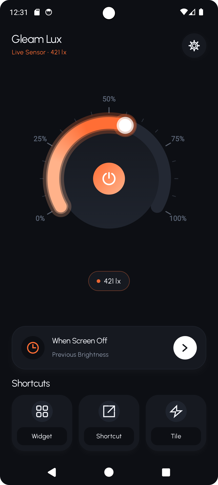
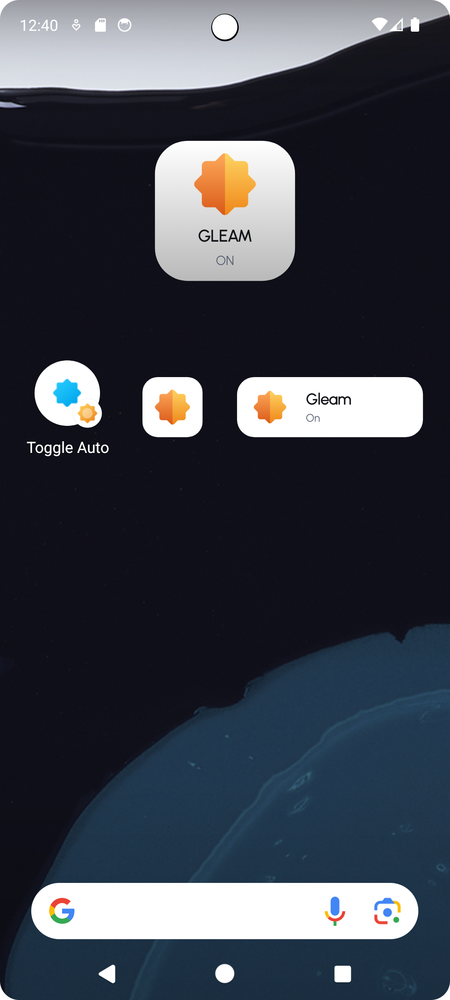
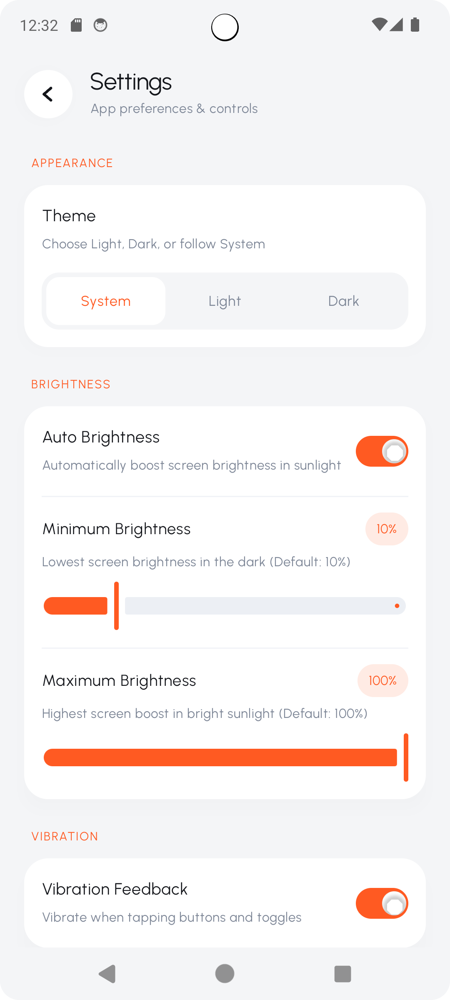
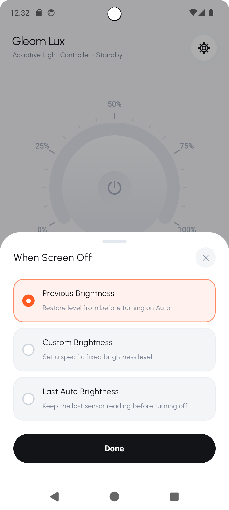

# Screenshots

[Back to Readme](../../README.md)

| Screenshot | Screenshot |
| :---: | :---: |
|  **Home** Main sunlight boost dial interface. |  **Home (Dark)** Pitch black AMOLED night theme. |
|  **Widget** One-tap home screen brightness widget. |  **Widget Settings** Widget configuration and preview options. |
|  **All Shortcuts** Quick launcher one-tap action shortcuts. |  **Shortcuts (Active)** Active automated boost shortcut state. |
|  **Settings** Custom brightness and vibration controls. |  **When Screen Off** Select display brightness restore mode. |
