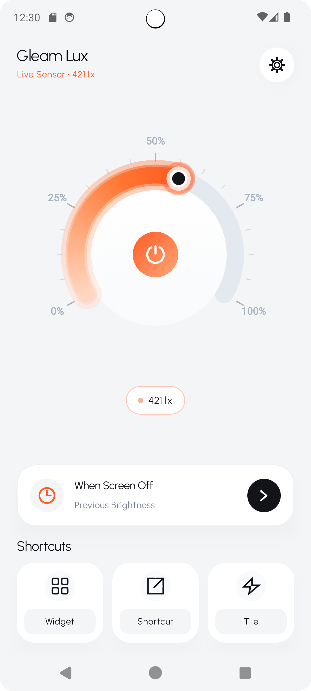
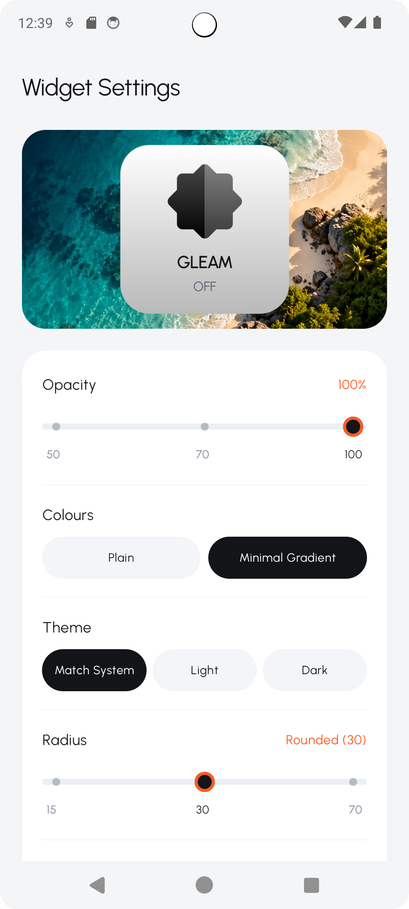
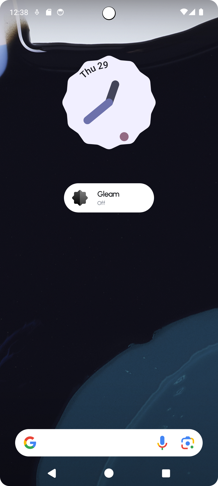
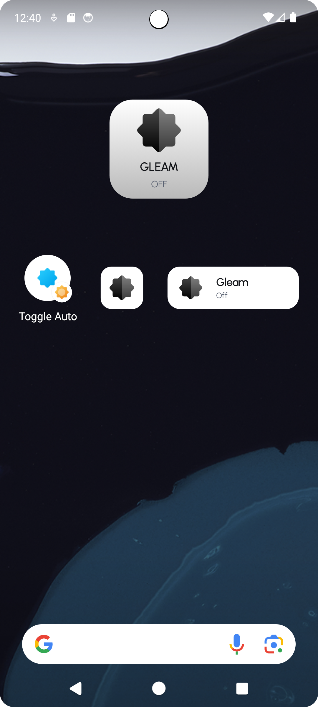

# Gleam
<p align="center">
  
  <br>
  <b>Instant auto-brightness by widgets, shortcuts, and notification tile.</b>
</p>

<p align="center">
  <a href="#-how-to-install">Installation</a> • <a href="#-screenshots">Screenshots</a>
</p>

Gleam provides the fastest way to control your display auto-brightness. It operates 100% on-device with zero network permissions, letting you manage your screen brightness with a single tap.

**Use Case:**
Digging through **system menus** or **swiping down** multiple times just to toggle auto-brightness is tedious and time-consuming. Gleam puts brightness control right at your fingertips, allowing you to instantly switch between manual and auto-brightness directly from your home screen or notification panel whenever your lighting conditions change.

---

## # Index
- [Screenshots](#-screenshots)
- [Features](#-features)
- [Installation and Download](#-how-to-install)
- [Contribute](#-how-to-contribute)
- [Requirements](#-requirements)
- [Troubleshooting](#-troubleshooting)
- [License & Legal](#-license--legal)
- [Privacy Policy](#-privacy-policy)
- [Links](#-links)
- [Contributing / Developing](#-contributing--developing)
- [Author](#-author)

---

## # Screenshots
> [!NOTE] 
> [All Screenshots](.github/screenshots/Screenshots.md)

| Home | Widget Settings |
| :---: | :---: |
|  |  |
|  |  |
---

## # Features
- **Sunlight Auto-Boost:** Maximizes display visibility instantly when entering bright outdoor sunlight.
- **Physical Sensor Reading:** Reads hardware ambient light directly using low-latency sensor listeners.
- **Custom Restore Profiles:** Return to previous brightness, custom floor, or last sensor reading upon screen off.
- **Tactile Dial Interface:** Control brightness levels with spring physics and zero visual latency.
- **Zero Network Permissions:** Operates completely offline with 100% on-device privacy.
- **Quick Settings Tile:** Toggle brightness boost with one tap from the notification shade or home screen.

---

## # How to install

> **Download:** [Get the latest release here](https://github.com/SubhamSathua/gleam/releases)

1. **Download APK:** Download the latest `app-debug.apk` or release build from the releases page.
2. **Install on Device:** Open the downloaded APK on your Android device and confirm installation.
3. **Grant Permission:**
   - Launch Gleam.
   - Tap the red permission banner or toggle the power button.
   - Enable "Allow modifying system settings" so Gleam can adjust the screen backlight.
4. **Start Boosting:** Tap the central power button to activate automated sunlight boost.

---

## # How to contribute
We welcome contributions. Follow these steps to build and run Gleam locally:

1. **Clone the Repo:**
   ```bash
   git clone https://github.com/SubhamSathua/gleam.git
   ```
2. **Open in Android Studio:**
   - Open Android Studio Ladybug or newer.
   - Select "Open an Existing Project" and choose the `Gleam` directory.
   - Allow Gradle sync to complete (JDK 17+ recommended).
3. **Build Binary:**
   - To build the debug APK via CLI:
     ```bash
     ./gradlew assembleDebug
     ```
   - APK output directory: `app/build/outputs/apk/debug/app-debug.apk`

---

## # Requirements
- **OS:** Android 8.0 (Oreo / API level 26) or higher.
- **Hardware:** Physical ambient light sensor (TYPE_LIGHT). Emulators fallback to system brightness level.
- **Permission:** System Settings Write permission (`android.permission.WRITE_SETTINGS`).
- **Network:** None. Gleam does not require an Internet connection.

---

## # Troubleshooting
- **Permission Not Granted:** Ensure "Modify system settings" is turned ON in Android Settings > Apps > Gleam.
- **Sensor Readings Inactive:** Verify your device's ambient light sensor at the top bezel is not blocked by a case or opaque screen protector.
- **Brightness Does Not Revert:** Check your "When Screen Off" restore mode preference in the app.

---

## # License & Legal
This project is licensed under the **Apache License 2.0**.

**Liability Protection:** The author provides this software "as is" without warranties. By using this software, you agree that the author is not liable for any damages, battery degradation, or screen hardware issues resulting from its use.

**Modifications:** If you modify and distribute this software, you must:
1. Retain all original copyright notices.
2. Include a copy of the Apache License.
3. Protect the original author from liability claims arising from your modified version.

---

## # Privacy Policy
- **100% Local:** All sensor reading and backlight adjustments happen strictly on your device.
- **No Internet Required:** The application contains zero network code and does not request `android.permission.INTERNET`.
- **No Tracking:** Zero telemetry, zero analytics, and zero background user profiling.

---

## # Links
- [Download Releases](https://github.com/SubhamSathua/gleam/releases) - Get the latest APK builds.
- [Report an Issue](https://github.com/SubhamSathua/gleam/issues) - Report bugs or regressions.
- [Community Discussions](https://github.com/SubhamSathua/gleam/discussions) - Ask questions and share feedback.
- [Security Policy](SECURITY.md) - Guidelines for reporting vulnerabilities.
- [Feedback Form](https://tally.so/r/aOO1oZ) - Submit web feedback directly.
- [Apache 2.0 License](LICENSE)

---

## # Contributing / Developing
- **Issues:** [Report Bugs & Suggestions](https://github.com/SubhamSathua/gleam/issues) - Track bug reports and feature requests.
- **Discussions:** [Community Discussions](https://github.com/SubhamSathua/gleam/discussions) - Share ideas, ask questions, and discuss improvements.
- **Security / Private:** [contact.hefty730@slmail.me](mailto:contact.hefty730@slmail.me) - Report security vulnerabilities privately. Do not open public issues for security exploits.

---

## # Author
**Author:** Subham Kumar Sathua
**GitHub Profile:** [@SubhamSathua](https://github.com/SubhamSathua)

---
Copyright (c) 2026 Subham Kumar Sathua. Licensed under the Apache License 2.0.
